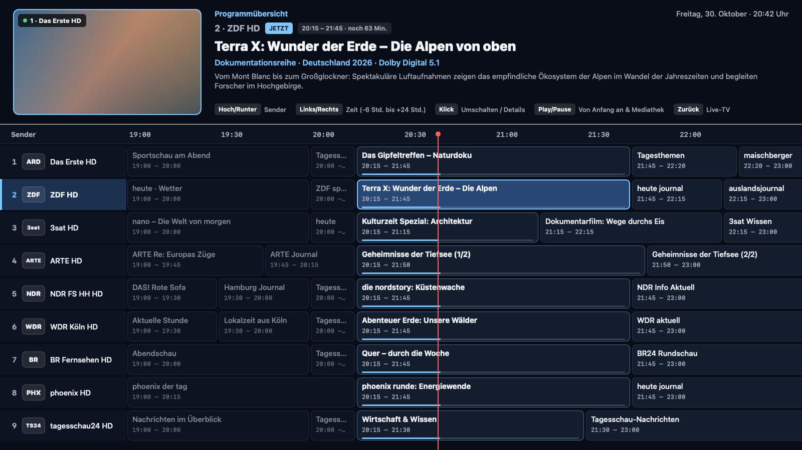
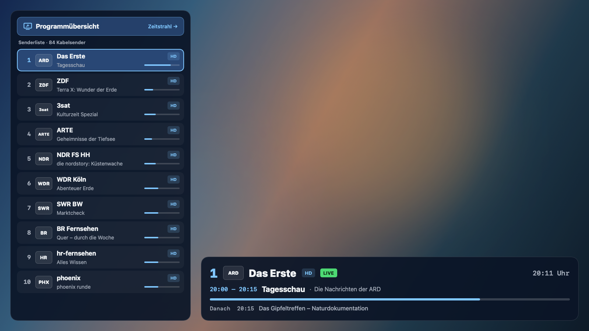
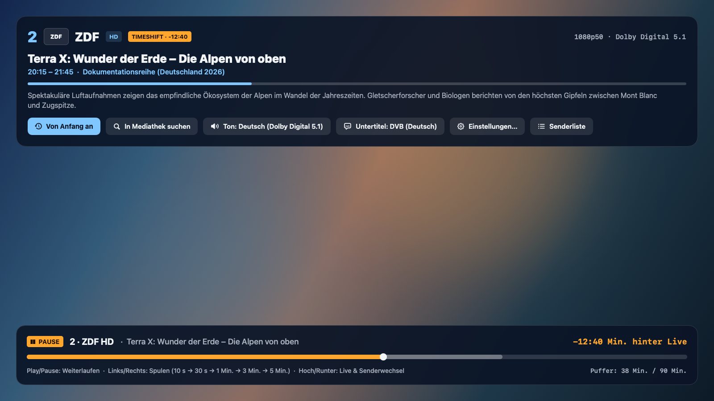
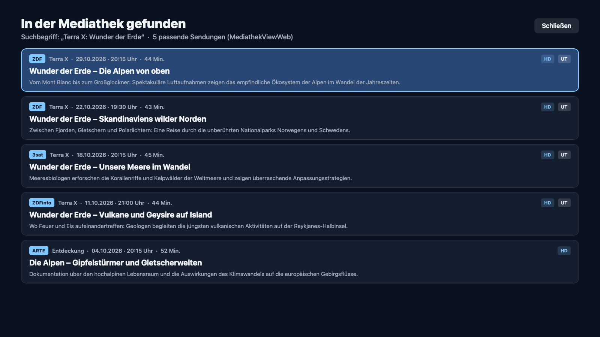

# FritzTV – DVB-C-Wiedergabe von der FRITZ!Box Cable auf tvOS und macOS

[](#installation)
[](#aufbau)
[](#funktionen)
[](LICENSE)

**FritzTV** ist ein SwiftUI-Client für tvOS und macOS, der die RTSP-Streams des integrierten DVB-C-Tuners einer AVM FRITZ!Box Cable wiedergibt. Die Verbindung läuft direkt zur Box (Heimnetz oder WireGuard-VPN), ohne Zwischenserver. **FritzRadio** ist eine separate macOS-Menüleisten-App für die Radiosender derselben Quelle.

> **English summary:** Native tvOS and macOS client for the DVB-C tuner of AVM FRITZ!Box Cable routers (6690, 6670, 6660, 6591, 6590, 6490 Cable, FRITZ!WLAN Repeater DVB-C). Plays unencrypted cable channels via RTSP/M3U using VLCKit. Features: EPG timeline from DVB-EIT and XMLTV (−6 h to +22 h), local timeshift buffer, start-over via public broadcasters' HLS streams, MediathekViewWeb search with subtitles, TR-064 station scan, UPnP tuner diagnostics. FritzRadio is a macOS menu bar app for the cable radio stations (logos, now/next from DVB-EIT, favorites, media keys).

Xcode-Targets:

| Target | Plattform | Beschreibung |
| :--- | :--- | :--- |
| `FritzTV-tvOS` | tvOS 17+ | Bedienung per Siri Remote, Ausgabe mit 50 Hz |
| `FritzTV-macOS` | macOS 14+ | Bedienung per Tastatur, Maus, Trackpad |
| `FritzRadio` | macOS 14+ | Menüleisten-App ohne Dock-Symbol, nur Radiosender |

## Voraussetzungen

FRITZ!Box mit integriertem DVB-C-Tuner; in FRITZ!OS muss **DVB-C → Live-TV** aktiviert sein.

| Gerät | Tuner | Standard-Hostname |
| :--- | :--- | :--- |
| FRITZ!Box 6690 Cable | 4× DVB-C | `fritz.box` (`192.168.178.1`) |
| FRITZ!Box 6670 Cable | 4× DVB-C | `fritz.box` (`192.168.178.1`) |
| FRITZ!Box 6660 Cable | 4× DVB-C | `fritz.box` (`192.168.178.1`) |
| FRITZ!Box 6591 Cable | 4× DVB-C | `fritz.box` (`192.168.178.1`) |
| FRITZ!Box 6590 Cable | 4× DVB-C | `fritz.box` (`192.168.178.1`) |
| FRITZ!Box 6490 Cable | 4× DVB-C | `fritz.box` (`192.168.178.1`) |
| FRITZ!WLAN Repeater DVB-C | 2× DVB-C | `fritz.repeater` |

Einschränkungen:

- **Kabelnetz:** Die Senderzuordnung erfolgt über den Sendernamen (`groupKey`), nicht über Frequenzen. Damit ist die App unabhängig von der Kanalbelegung des Netzbetreibers.
- **Öffentlich-rechtliche Sender:** ARD und ZDF senden im Kabel nur noch in HD. Verwaiste SD-Einträge werden gefiltert; eine SD-Variante bleibt nur erhalten, wenn das Netz keine HD-Variante führt.
- **Private Sender:** Nur die unverschlüsselten SD-Varianten sind empfangbar. Private HD-Sender sind grundverschlüsselt (CI+), die FRITZ!Box kann sie nicht entschlüsseln.
- **Nicht unterstützt:** FRITZ!Box 6430 Cable sowie DSL- und Glasfaser-Modelle (z. B. 7590, 7690, 5590) – kein DVB-C-Tuner.
- **Provider-Firmware:** Auf gebrandeten Mietgeräten kann der Menüpunkt *DVB-C / Live-TV* ausgeblendet sein.

## Ansichten

| Programmübersicht (EPG-Zeitstrahl) | Live-TV mit Senderliste und Infotafel |
| :---: | :---: |
|  |  |
| **Sendungsinfo, „Von Anfang an“, Timeshift** | **Mediathek-Suche** |
|  |  |

Die Screenshots werden mit `scripts/make-screenshots.swift` aus Beispieldaten erzeugt.

## Installation

### Release-Build (macOS)

1. Unter [Releases](https://github.com/DrkBnkl/FritzTV/releases) `FritzTV-macOS-Universal.zip` bzw. `FritzRadio-macOS-Universal.zip` herunterladen und entpacken (Universal Binary: Apple Silicon und Intel).
2. `FritzTV.app` bzw. `FritzRadio.app` nach `/Applications` verschieben.
3. **Gatekeeper:** Die Apps sind ad-hoc signiert und nicht notarisiert. macOS blockiert daher den ersten Start.
   - macOS 15+: App starten, dann **Systemeinstellungen › Datenschutz & Sicherheit › Trotzdem öffnen**.
   - macOS 14: Rechtsklick auf die App › **Öffnen** › **Öffnen**.
   - Alternativ das Quarantäne-Attribut entfernen:
     ```bash
     xattr -cr /Applications/FritzTV.app
     ```

### Build aus dem Quellcode

Voraussetzungen: Xcode, [XcodeGen](https://github.com/yonaskolb/XcodeGen) (wird von `setup.sh` bei Bedarf über Homebrew installiert).

1. `./setup.sh` erzeugt `FritzTV.xcodeproj` aus `project.yml` und öffnet das Projekt. `project.yml` ist die maßgebliche Projektdefinition; das `.xcodeproj` wird bei jedem Aufruf neu erzeugt.
2. Beim ersten Öffnen lädt Xcode das Swift-Paket VLCKit (ca. 200 MB).
3. Build-Skripte:

| Skript | Ergebnis |
| :--- | :--- |
| `scripts/deploy-macos.sh` | Release-Build (Universal), Installation nach `/Applications/FritzTV.app` |
| `scripts/deploy-fritzradio.sh` | Release-Build, Installation nach `/Applications/FritzRadio.app` |
| `scripts/deploy-tvos.sh` | Release-Build, Installation per `xcrun devicectl` auf ein gekoppeltes Apple TV; App-Daten und Einstellungen bleiben erhalten |
| `scripts/make-release.sh` | Universal-ZIPs bauen und prüfen; mit `--publish <notes.md>` zusätzlich taggen und GitHub-Release anlegen |

Für die tvOS-Signatur genügt ein kostenloses „Personal Team“; das Team wird aus der Umgebung oder der in Xcode angemeldeten Apple-ID ermittelt.

### Zugriff außerhalb des Heimnetzes

Über das WireGuard-VPN der FRITZ!Box. Schlägt die Namensauflösung von `fritz.box` fehl, verwendet die App `192.168.178.1`.

## Bedienung

### Live-Bild

| Siri Remote | Mac | Funktion |
| --- | --- | --- |
| Hoch / Runter (Ring-Klick) | ↑ / ↓, `⌘→` / `⌘←` | Nächster / vorheriger Sender |
| Nach oben wischen | – | Senderleiste am unteren Rand |
| Klick oder nach unten wischen | Return / `⌘I` / Info-Knopf in der Steuerleiste / Rechtsklick | Sendungsinfo: Tonspur, Untertitel, „Von Anfang an“, „In Mediathek suchen“, Einstellungen |
| Zurück | Esc / `⌃⌘S` / Klick ins Bild | Senderliste (Mausrad-Scrollen, Hover-Vorschau) |
| – | `⌘E` / Rechtsklick | Programmübersicht |
| – | Doppelklick ins Bild / `⌃⌘F` | Vollbild umschalten |
| Play/Pause | Leertaste / `⌘P` | Timeshift: anhalten / fortsetzen |
| Links / Rechts | ← / → oder Ziehen in der Zeitleiste | Timeshift: Spulen mit wachsender Schrittweite (10 s → 30 s → 1 min → 3 min → 5 min) |
| – | `⌘L` / Klick auf „LIVE“ | Timeshift: zurück zum Live-Bild |
| – | `⇧⌘←` | Sendung von Anfang an (Sender mit öffentlichem HLS-Stream) |
| – | `⌘↑` / `⌘↓`, `⌥⌘↓` | Lautstärke der App, Ton aus |
| – | Ziffern / Mausklick | Direktwahl |

Auf dem Mac erscheint bei Mausbewegung über dem Bild, nach dem Umschalten und während der Pause eine Steuerleiste: Sender, laufende Sendung, Timeshift-Zeitleiste mit „LIVE“-Knopf, Info-Knopf für die Sendungsinfo, Menü für Tonspur und Untertitel, eigene Lautstärke (unabhängig von der Systemlautstärke, gespeichert) und Vollbild. Nach 3 s ohne Mausbewegung blenden sich Leiste, Fensterknöpfe und Mauszeiger aus. Alle Befehle stehen zusätzlich in den Menüs „Wiedergabe“ und „Sender“.

### Programmübersicht (EPG-Zeitstrahl)

| Eingabe | Funktion |
| --- | --- |
| ↑ / ↓ | Senderzeile wechseln (Siri Remote: gedrückt halten für schnelles Blättern) |
| ← / → | Von Sendung zu Sendung, Bereich −6 h bis +22 h |
| Klick / Return | Laufende Sendung: umschalten. Andere Sendung: Detailtafel mit Beschreibung, „In Mediathek suchen“, „Umschalten“ |
| Play/Pause / Leertaste | Auf „Jetzt“: Detailtafel der laufenden Sendung (inkl. „Von Anfang an“). Bei verschobenem Zeitstrahl: zurück zu „Jetzt“ |

### FritzRadio

| Eingabe | Funktion |
| --- | --- |
| Klick auf Sender / Return im Suchfeld | Sender bzw. ersten Suchtreffer abspielen |
| Leertaste / `⌘P` | Abspielen / Anhalten (Anhalten gibt den Tuner frei) |
| `⌘←` / `⌘→` | Voriger / nächster Sender |
| `⌘↑` / `⌘↓` | Lautstärke |
| `⌘1` … `⌘9` | Favorit 1–9 |
| `⌘D` / Rechtsklick auf Sender | Favorit setzen / entfernen |
| `⌘F` / Esc | Suche / Suche leeren |
| `⌘R` | Senderliste neu laden |
| `⌘,` | Einstellungen |

## Funktionen

- **Live-TV:** Wiedergabe der RTSP-Streams mit VLCKit. Pro Sender werden alle Frequenzvarianten der Reihe nach probiert (HD bevorzugt); die funktionierende Variante wird gespeichert. Liefert ein Sender nach 6 s kein Bild, werden fehlende Audio-/Video-PIDs aus der PMT ermittelt und im RTSP-Link ergänzt. Optional Schwarzbild beim Umschalten.
- **SD-Bild:** SD-Sender (576i) werden mit `yadif2x` deinterlaced: 50 Vollbilder pro Sekunde statt 25, passend zur 50-Hz-Ausgabe auf dem Apple TV. Wie bei einem Fernseher werden rund 2,5 % an jedem Rand abgeschnitten (Overscan) und das Bild dabei auf exakt 16:9 bzw. 4:3 gebracht; so verschwinden schwarze Randzeilen des Sendesignals und schmale Balken. Auf dem Mac lässt sich das SD-Bild zusätzlich vor dem Hochskalieren nachschärfen (VLC-Filter `sharpen`, abschaltbar, Standard aus); TVVLCKit enthält diesen Filter nicht.
- **EPG:** Für den aktuell empfangenen Multiplex werden DVB-EIT-Daten (inkl. Extended Event Descriptors) aus dem Stream gelesen. Alle übrigen Sender kommen aus einer komprimierten XMLTV-Quelle, die alle 12 h aktualisiert wird. Hintergrund: Die FRITZ!Box liefert pro Client-IP nur einen RTSP-Stream, ein zweiter Tuner für EPG-Daten steht nicht zur Verfügung.
- **Timeshift:** Der Live-Stream wird parallel in segmentierte TS-Dateien geschrieben (`TimeshiftBufferManager`, 30–120 min einstellbar). Wiedergabe aus dem Puffer ohne zusätzliche RTSP-Sitzung.
- **Von Anfang an:** Für öffentlich-rechtliche Sender wird auf deren HLS-Livestream gewechselt und über `EXT-X-PROGRAM-DATE-TIME` zum Sendungsbeginn gesprungen.
- **Mediathek-Suche:** Suche über die MediathekViewWeb-API nach Titel und Sender, Wiedergabe mit AVPlayer, Untertitel im Format EBU-TT-D/TTML und WebVTT.
- **Senderverwaltung:** Reihenfolge und Sichtbarkeit frei einstellbar. Sendersuchlauf der FRITZ!Box per TR-064. Tuner-Diagnose (Signalpegel, SNR, Belegung) per UPnP.
- **FritzRadio:** Sender nach Senderfamilien gruppiert (WDR, NDR, SWR, BR …), Favoriten, Verlauf, Suche. Senderlogos, laufende und folgende Sendung aus DVB-EIT (sofern gesendet). Anzeige von Codec, Abtastrate, Kanälen und Bitrate des laufenden Senders (abschaltbar; die Bitrate wird aus der Datenmenge geschätzt, da DVB sie nicht mitliefert). Steuerung über Medientasten und Kontrollzentrum, Start bei Anmeldung. Doppelte Einträge der Box werden zusammengefasst, Sender ohne Tonsignal ans Listenende sortiert. Während der Wiedergabe wird der Ruhezustand verhindert; nach dem Aufwachen wird die Verbindung neu aufgebaut.
- **Top Shelf (tvOS):** 12 Sender auf dem Home-Bildschirm, Deep Link `fritztv://channel/<nummer>`. Ohne App Group (kostenloses Personal Team) wird eine feste Standardliste angezeigt; die eigene Senderreihenfolge erfordert eine App Group und damit einen bezahlten Entwickler-Account (siehe `project.yml`).

## Aufbau

| Pfad | Inhalt |
| :--- | :--- |
| `FritzTVKit/` | Swift-Paket mit Unit-Tests: M3U-Parser, Senderkatalog und Sortierung, EIT-Log-Parser, XMLTV-Parser, `EPGStore`, Timeshift-Pufferverwaltung, MediathekViewWeb-Client, Untertitel-Parser (TTML/WebVTT), UPnP-Tunerstatus, TR-064-Sendersuchlauf |
| `App/Shared/` | Gemeinsamer App-Code: `AppModel`, `PlayerController` (VLCKit), `EPGOverviewView`, Overlays, `HLSReplayPlayerView`, `MediathekSearchResultsView`, `MediathekPlayer`, `SettingsView`, `XMLTVLoader` |
| `App/tvOS/` | Siri-Remote-Eingabe (`RemoteInput`), 50-Hz-Ausgabe (`DisplayCriteria`), UIKit-Videoview |
| `App/macOS/` | Tastatureingabe (`KeyboardInput`), AppKit-Videoview |
| `App/TopShelf/` | tvOS-Top-Shelf-Erweiterung |
| `App/Radio/` | FritzRadio: `RadioModel`, `RadioPlayer` (VLCKit), `RadioPanel`; Senderliste und Logos aus `FritzTVKit` (`RadioStations`, `ChannelLogo`) |
| `docs/anforderungen.md` | Architektur- und Funktionsbeschreibung |
| `project.yml` | XcodeGen-Projektdefinition |

## Lizenz

- **Quellcode:** [MIT-Lizenz](LICENSE).
- **VLCKit / libVLC:** [VLCKit](https://code.videolan.org/videolan/VLCKit) (VideoLAN), [LGPL v2.1](https://www.gnu.org/licenses/old-licenses/lgpl-2.1.html); auf macOS dynamisch eingebunden. Einzelne enthaltene Module stehen unter GPLv2 oder neuer. Lizenztexte und Quellenangaben: [`Licenses/`](Licenses/), in der App unter `Contents/Resources/Licenses`.
- **Mediathek-Suche:** Öffentliche API von [MediathekViewWeb](https://mediathekviewweb.de).
- **Marken:** *FRITZ!* und *FRITZ!Box* sind eingetragene Marken der AVM GmbH. Das Projekt ist unabhängig und steht in keiner Verbindung zu AVM oder den genannten Rundfunkanstalten.
